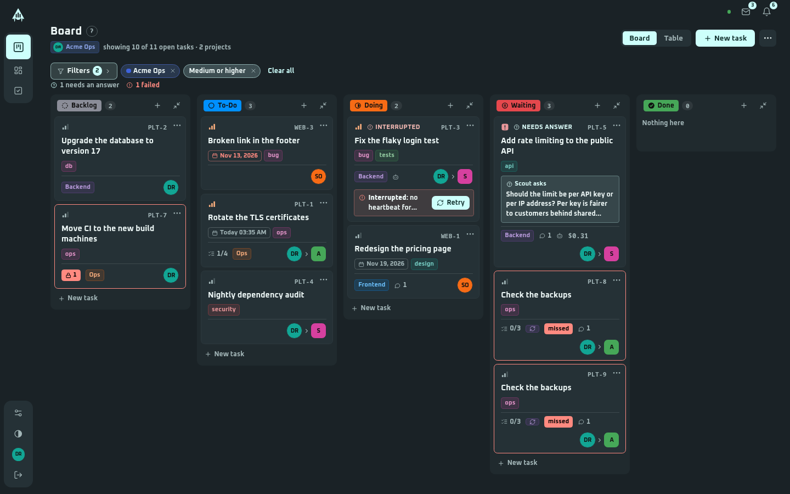
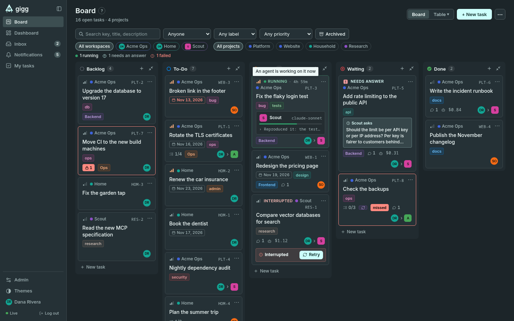
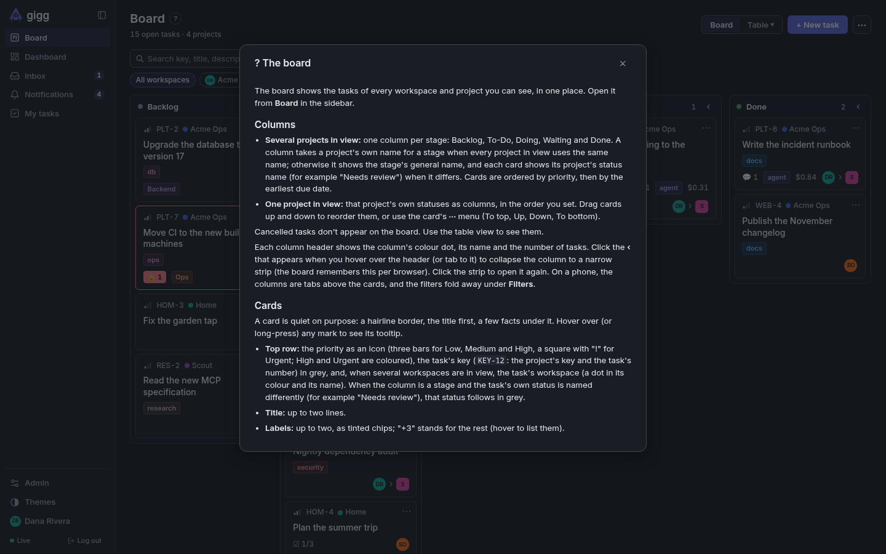

<p align="center"></p>

# gigg

A self-hosted task board for people and AI agents. Agents are users like everyone else: they get their own accounts and keys, see only what their access allows, pick up work, ask questions when they're stuck and report what they did. Everything is available in the web UI, the REST API and over MCP.

One Go binary with SQLite inside, a React UI built in, no other services.



## Features

- **One board for everything**: tasks from every workspace and project you can see, with filters (workspace, project, assignee, label, priority, text) kept in the URL. One project in view gives its own columns and manual order.
- **Tasks**: Markdown descriptions with @mentions, checklists, subtasks, dependencies (blocked tasks wait), custom fields, labels, colours, start and due dates, time windows (a task not started in time is marked missed), archive and trash.
- **Recurring tasks**: templates (content) and schedules (timing) are separate and reusable; a recurring task links one of each.
- **Agents**: runs with status, cost, turns and reports; agent sessions that can be resumed with your answer; questions that land in an inbox; per-task model, effort, *always run* and a tool allowlist for the agent; daily caps and a pause switch per workspace. See [Agents](docs/guide/agents.md).
- **MCP**: tools for tasks, comments, checklists, relations, templates, schedules, recurring tasks and runner control, for any MCP client (Claude Code and others). See [MCP](docs/reference/mcp.md).
- **Access control**: workspaces as the isolation boundary; preset roles plus per-permission overrides for users and groups, per workspace or everywhere; API keys limited by workspace, projects, scopes, listener, network and expiry.
- **Live updates**, a command palette (Ctrl+K), tables with bulk actions and saved views, a dashboard of agent runs, an audit log.
- **Themes**: dark and light built-ins, custom themes, import and export as JSON, follow the system setting.
- **Help built in**: tooltips on everything that isn't obvious, and a **?** on every page that opens the matching part of this guide.

<p> </p>


## Quick start (container)

There's no published image yet; build it from this repository (Podman or Docker):

```sh
podman build -t gigg .
podman volume create gigg-data
podman run -d --name gigg -p 8080:8080 -v gigg-data:/data \
  -e GIGG_PUBLIC_URL=http://localhost:8080 gigg
```

Create the first admin and set a password (it asks on the terminal):

```sh
podman exec -it gigg /gigg admin user-add admin -admin -name "Admin"
podman exec -it gigg /gigg admin passwd admin
```

Open <http://localhost:8080>, sign in, and create a workspace and a project under **Admin → Workspaces**.

The server only answers to the host names it knows: `localhost` and the host of `GIGG_PUBLIC_URL` (other names get 421 until you add them with `GIGG_ALLOWED_HOSTS`). Set `GIGG_DEFAULT_TZ` to your team's time zone (the default is UTC). An image built this way reports its version as `dev`; pass `--build-arg VERSION=1.2.3` to name it.

For HTTPS, a second listener for agents on loopback, running behind a reverse proxy, backups and a systemd (Quadlet) unit, see [Configuration](docs/reference/configuration.md) and [`deploy/gigg.container.example`](deploy/gigg.container.example).

## Building it natively

You need Go 1.27 and Node.js 24.

```sh
(cd web && npm ci && npm run build)    # the UI, embedded into the binary
go build -o gigg ./cmd/gigg
GIGG_DATA_DIR=./data ./gigg admin user-add admin -admin
GIGG_DATA_DIR=./data ./gigg admin passwd admin
GIGG_DATA_DIR=./data GIGG_PUBLIC_URL=http://localhost:8080 ./gigg serve
```

## Connecting an agent

Create an agent user, give it a workspace, and make a key for it, in **Admin** (Users, Workspaces, Keys) or with the CLI. With the container from the quick start (natively, run `GIGG_DATA_DIR=./data ./gigg admin ...` instead):

```sh
podman exec gigg /gigg admin workspace-add acme "Acme"
podman exec gigg /gigg admin project-add acme ops Ops OPS
podman exec gigg /gigg admin user-add scout -agent -name Scout
podman exec gigg /gigg admin member acme scout member
podman exec gigg /gigg admin key-add -user scout -workspace acme -name scout-mcp \
  -scopes workspace:read,tasks:read,tasks:write,comments:read,comments:write,runs:write > scout.key
```

The key is printed once (here into `scout.key`); keep it like a password.

Then point the agent's MCP client at the board, for example Claude Code:

```sh
claude mcp add --transport http gigg http://localhost:8080/mcp \
  --header "Authorization: Bearer $(cat scout.key)"
```

To have agents work tasks unattended, run a runner next to them: a small script of your own that drives your agent CLI (gigg doesn't ship one). The [runner protocol](docs/reference/runner-protocol.md) explains how to claim tasks, record runs and report back.

## Documentation

**User guide** (also shown in the app under each page's **?**):
[The board](docs/guide/board.md) ·
[Tasks](docs/guide/tasks.md) ·
[Agents](docs/guide/agents.md) ·
[Recurring tasks](docs/guide/recurring.md) ·
[Dashboard](docs/guide/dashboard.md) ·
[Inbox and notifications](docs/guide/inbox.md) ·
[Views](docs/guide/views.md) ·
[Themes](docs/guide/themes.md) ·
[Profile](docs/guide/profile.md) ·
[Administration](docs/guide/admin.md)

**Reference**:
[Configuration](docs/reference/configuration.md) ·
[Admin CLI](docs/reference/admin-cli.md) ·
[REST API](docs/reference/api.md) ·
[MCP](docs/reference/mcp.md) ·
[Access control](docs/reference/access.md) ·
[Runner protocol](docs/reference/runner-protocol.md)

The screenshots come from a demo instance (`dev/demo`), taken by a script (`dev/shot/docs-scenario.py`), so they can be re-taken whenever the UI changes.

## Status

gigg is in daily use, but young. The API is versioned (`/api/v1`). Database migrations run automatically on start, after a snapshot of the database.

## License

Copyright © 2026 Alx. gigg is free software under the [GNU Affero General Public License v3.0 only](LICENSE) (`AGPL-3.0-only`): you may use, change and share it, and if you run a modified version as a network service, you must offer its source to the people using it. Contributions are welcome under the [contributor license agreement](CLA.md) (see [CONTRIBUTING](CONTRIBUTING.md)), which also lets the maintainer offer gigg under other terms, such as a hosted or commercial edition.

The fonts bundled with the web UI are under the SIL Open Font License 1.1; their notices are in [web/public/fonts-licenses.txt](web/public/fonts-licenses.txt), which every server also serves at `/fonts-licenses.txt`.
