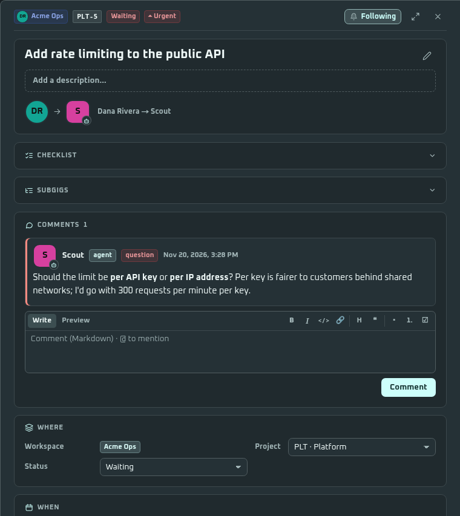
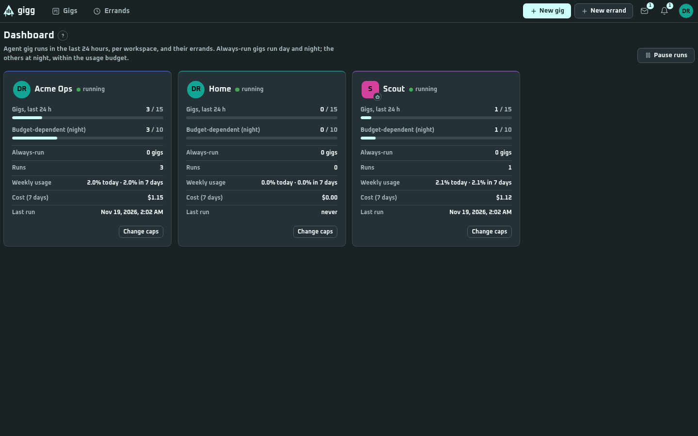
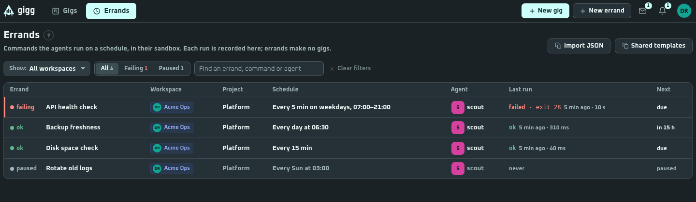
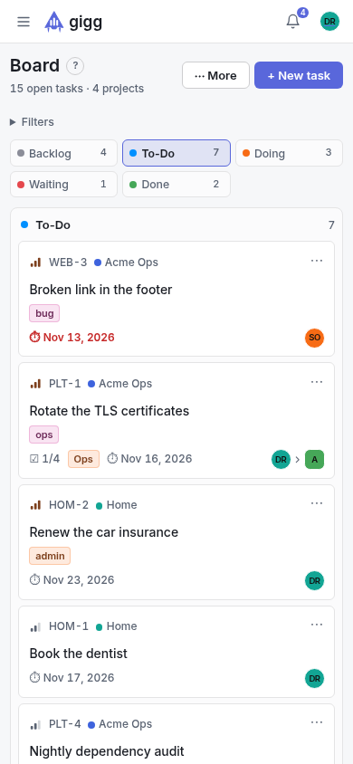
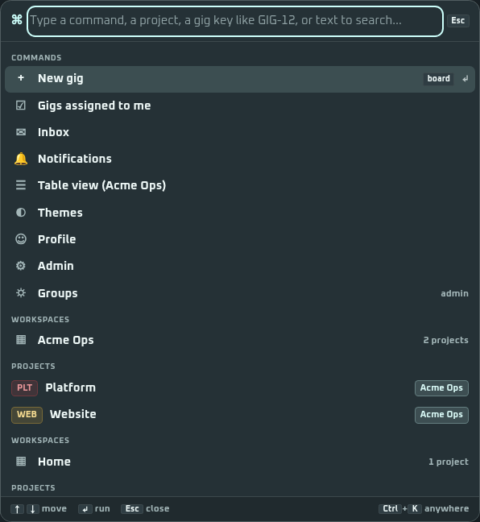
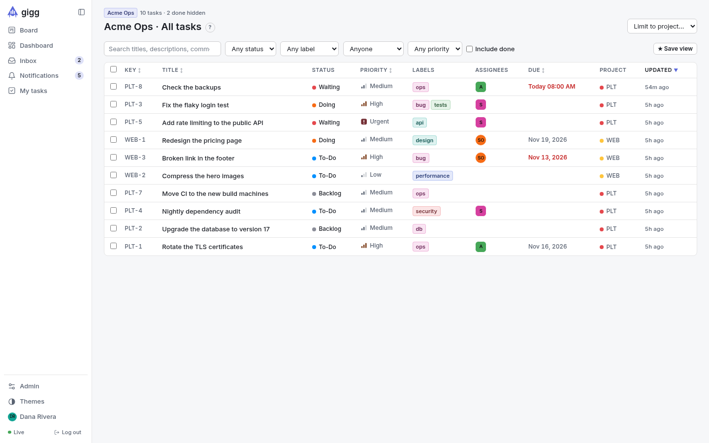
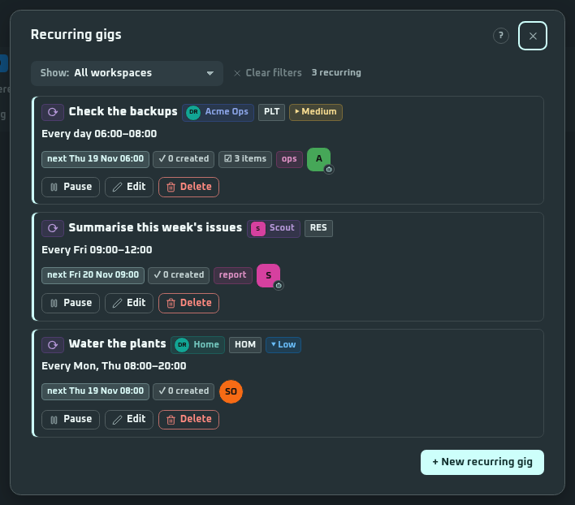
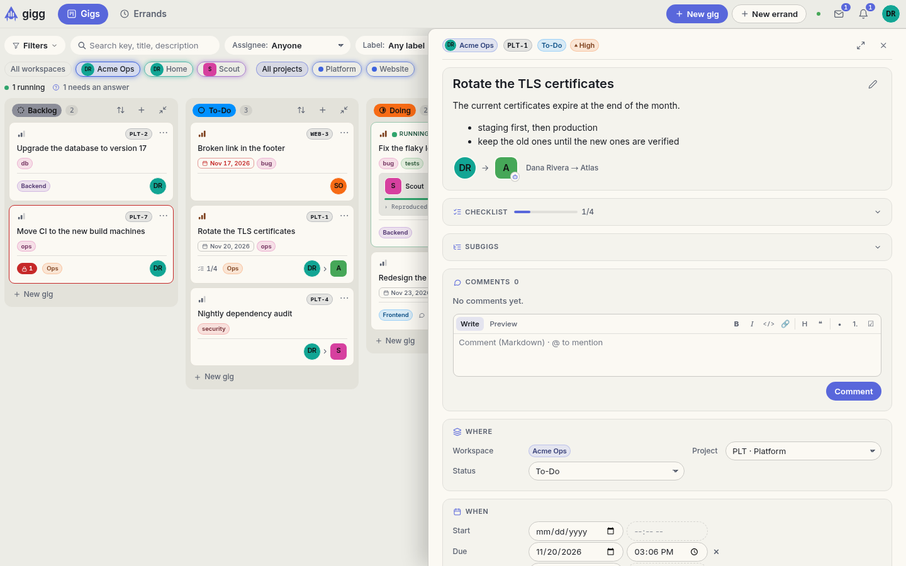

<p align="center">
  <picture>
    <source media="(prefers-color-scheme: dark)" srcset="assets/brand/png/logo-wordmark.png">
    
  </picture>
</p>

<p align="center">
  <a href="LICENSE"></a>
  <a href="go.mod"></a>
</p>

# gigg

**Hand work to your AI agents, and keep an eye on it.**

gigg is a self-hosted gig board that people and AI agents share. Agents pick up gigs, ask when they're stuck and report what they did, in the web UI, over the REST API or over MCP.

It tracks two kinds of work:

- **Gigs** are prompt-based tasks for AI agents (and people): the agent reads the gig and thinks it through.
- **Errands** are command-based tasks for computers and systems: a shell command run on a schedule, with no thinking involved.

## Why gigg

- **Agents are real users.** Each one has its own account, keys and limits, sees only what its access allows, and every run leaves its status, cost and report on the gig.
- **They ask when they're stuck.** An agent's question lands in your inbox; you answer there, and the agent picks up where it left off.
- **One self-hosted binary.** Go with SQLite inside and the web UI built in: no other services to run.


## Features

- **One board for everything**: gigs from every workspace and project you can see, with filters (workspace, project, assignee, label, priority, text) kept in the URL. One project in view gives its own columns and manual order.
- **Gigs**: Markdown descriptions with @mentions, checklists, subgigs, dependencies (blocked gigs wait), custom fields, labels, colours, start and due dates, time windows (a gig not started in time is marked missed), archive and trash.
- **Recurring gigs**: templates (content) and schedules (timing) are separate and reusable; a recurring gig links one of each.
- **Errands**: shell commands an agent runs on a schedule (every 15 minutes, every weekday at 06:30), inside its sandbox, for checks and housekeeping that need no thinking. Every run's status, exit code and output is kept, and failing errands come first on the Errands page and show on the dashboard. See [Errands](docs/guide/errands.md).
- **Agents**: on a card, a person's picture, then **›**, then an agent's means that person handed the gig to that agent; runs with status, cost, turns and reports; agent sessions that can be resumed with your answer; questions that land in an inbox; per-gig model, effort, *always run* and a tool allowlist for the agent; daily caps and a pause switch per workspace. See [Agents](docs/guide/agents.md).
- **MCP**: tools for gigs, comments, checklists, relations, templates, schedules, recurring gigs and runner control, for any MCP client (Claude Code and others). See [MCP](docs/reference/mcp.md).
- **Access control**: workspaces as the isolation boundary; preset roles plus per-permission overrides for users and groups, per workspace or everywhere; API keys limited by workspace, projects, scopes, listener, network and expiry.
- **Live updates**, a command palette (Ctrl+K), tables with bulk actions and saved views, a dashboard of agent runs, an audit log.
- **Themes**: dark and light built-ins, custom themes (or one any AI assistant designs from your description), import and export as JSON, follow the system setting.
- **Help built in**: tooltips on everything that isn't obvious, and a **?** on every page that opens the matching part of the user guide.

## Screenshots

<table>
<tr>
<td width="50%" valign="top"><a href="docs/guide/agents.md"></a><br><sub><b>An agent asks.</b> The gig waits for your answer, here or in the inbox.</sub></td>
<td width="50%" valign="top"><a href="docs/guide/dashboard.md"></a><br><sub><b>Dashboard.</b> Each workspace's agent runs, caps, usage and cost.</sub><br><br><a href="docs/guide/errands.md"></a><br><sub><b>Errands.</b> Scheduled commands, failing ones first.</sub></td>
</tr>
<tr>
<td align="center" valign="top"><a href="docs/guide/board.md"></a><br><sub><b>On a phone.</b> The same board, one column at a time.</sub></td>
<td valign="top"><a href="docs/guide/views.md"></a><br><sub><b>Command palette</b> (Ctrl+K): find a gig, jump to a project, run a command.</sub><br><br><a href="docs/guide/views.md"></a><br><sub><b>Table.</b> Filters, bulk actions and saved views.</sub></td>
</tr>
<tr>
<td valign="top"><a href="docs/guide/recurring.md"></a><br><sub><b>Recurring gigs.</b> A template and a schedule each.</sub></td>
<td valign="top"><a href="docs/guide/gigs.md"></a><br><sub><b>A gig</b>, open beside the board: details, checklist, comments, history.</sub></td>
</tr>
</table>

## Quick start (container)

There's no published image yet; build it from this repository (Podman or Docker):

```sh
podman build -t gigg .
podman volume create gigg-data
podman run -d --name gigg -p 127.0.0.1:8080:8080 -v gigg-data:/data \
  -e GIGG_PUBLIC_URL=http://localhost:8080 gigg
```

Create the first admin and set a password (it asks on the terminal):

```sh
podman exec -it gigg /gigg admin user-add admin -admin -name "Admin"
podman exec -it gigg /gigg admin passwd admin
```

Open <http://localhost:8080>, sign in, and create a workspace and a project under **Admin → Workspaces**.

The server only answers to the host names it knows: `localhost` and the host of `GIGG_PUBLIC_URL` (other names get 421 until you add them with `GIGG_ALLOWED_HOSTS`). Set `GIGG_DEFAULT_TZ` to your team's time zone (the default is UTC). An image built this way reports the version in `internal/version`; pass `--build-arg VERSION=1.2.3` to name it otherwise.

This serves plain HTTP on this machine only. For use over a network, turn on TLS (or put gigg behind
an HTTPS reverse proxy) first. For HTTPS, a second listener for agents on loopback, running behind a reverse proxy, backups and a systemd (Quadlet) unit, see [Configuration](docs/reference/configuration.md) and [`deploy/gigg.container.example`](deploy/gigg.container.example).

## Building it natively

You need Go 1.27 and Node.js 24.

```sh
(cd web && npm ci && npm run build)    # the UI, embedded into the binary
go build -o gigg ./cmd/gigg
GIGG_DATA_DIR=./data ./gigg admin user-add admin -admin
GIGG_DATA_DIR=./data ./gigg admin passwd admin
GIGG_DATA_DIR=./data GIGG_LISTEN=127.0.0.1:8080 GIGG_PUBLIC_URL=http://localhost:8080 ./gigg serve
```

## Connecting an agent

Create an agent user, give it a workspace, and make a key for it, in **Admin** (Users, Workspaces, Keys) or with the CLI. With the container from the quick start (natively, run `GIGG_DATA_DIR=./data ./gigg admin ...` instead):

```sh
podman exec gigg /gigg admin workspace-add acme "Acme"
podman exec gigg /gigg admin project-add acme ops Ops OPS
podman exec gigg /gigg admin user-add scout -agent -name Scout
podman exec gigg /gigg admin member acme scout member
podman exec gigg /gigg admin key-add -user scout -workspace acme -name scout-mcp \
  -scopes workspace:read,gigs:read,gigs:write,comments:read,comments:write,runs:write > scout.key
```

The key is printed once (here into `scout.key`); keep it like a password.

Then point the agent's MCP client at the board, for example Claude Code:

```sh
claude mcp add --transport http gigg http://localhost:8080/mcp \
  --header "Authorization: Bearer $(cat scout.key)"
```

To have agents work gigs unattended, run a runner next to them: a small script of your own that drives your agent CLI (gigg doesn't ship one). The [runner protocol](docs/reference/runner-protocol.md) explains how to claim gigs, record runs and report back.

## Documentation

Start at the [documentation index](docs/README.md), or jump straight to a page:

**User guide** (also shown in the app under each page's **?**):
[The board](docs/guide/board.md) ·
[Gigs](docs/guide/gigs.md) ·
[Agents](docs/guide/agents.md) ·
[Recurring gigs](docs/guide/recurring.md) ·
[Errands](docs/guide/errands.md) ·
[Dashboard](docs/guide/dashboard.md) ·
[Metrics](docs/guide/metrics.md) ·
[Inbox and notifications](docs/guide/inbox.md) ·
[Views](docs/guide/views.md) ·
[Themes](docs/guide/themes.md) ·
[Profile](docs/guide/profile.md) ·
[Administration](docs/guide/admin.md)

**Reference**:
[Configuration](docs/reference/configuration.md) ·
[Admin CLI](docs/reference/admin-cli.md) ·
[REST API](docs/reference/api.md) ·
[MCP](docs/reference/mcp.md) ·
[Access control](docs/reference/access.md) ·
[Runner protocol](docs/reference/runner-protocol.md)

The screenshots come from a demo instance (`dev/demo`), taken by a script (`dev/shot/docs-scenario.py`), so they can be re-taken whenever the UI changes.

## Status

gigg is in daily use, but young. The API is versioned (`/api/v1`). Database migrations run automatically on start, after a snapshot of the database.

## License

Copyright © 2026 Alx. gigg is free software under the [GNU Affero General Public License v3.0 only](LICENSE) (`AGPL-3.0-only`): you may use, change and share it, and if you run a modified version as a network service, you must offer its source to the people using it. Contributions are welcome under the [contributor license agreement](CLA.md) (see [CONTRIBUTING](CONTRIBUTING.md)), which also lets the maintainer offer gigg under other terms, such as a hosted or commercial edition.

The fonts bundled with the web UI are under the SIL Open Font License 1.1; their notices are in [web/public/fonts-licenses.txt](web/public/fonts-licenses.txt), which every server also serves at `/fonts-licenses.txt`.
