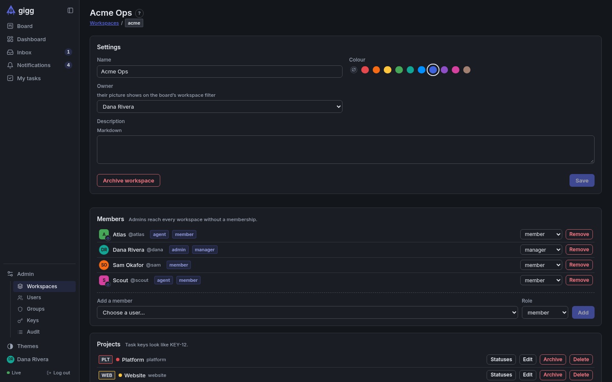
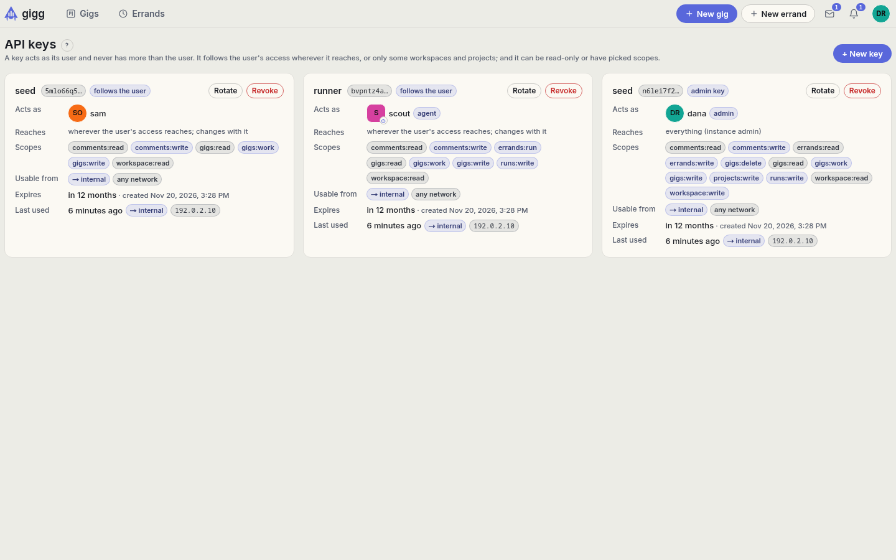

# Administration

Admins see **Admin** in the account menu (their picture, top right); click it for its sections. Everything here is also available through the API; the essentials (users, passwords, workspaces, members, access rules, projects, keys) through the `gigg admin` command line too.

## Workspaces

A workspace is the unit of isolation: its own members, projects, labels, custom fields, templates and schedules. A key limited to one workspace never sees another.

- **Settings**: name, colour (its badge and chips everywhere: the board's filters and cards, the gig header, tables, the dashboard), owner (whose picture marks it on the board's workspace filter), description, archive.
- **Members**: who belongs and with which preset role (viewer, consumer, member, manager). **Where** adds someone to the whole workspace or to one project only (viewer, consumer or member there): they then see that project and its gigs, and nothing else of the workspace. A member's own project rules are listed under them. Admins reach every workspace without a membership.
- **Projects**: each project has a name, a key (gig keys look like `KEY-12`), a colour, a description (what it is about; agents get it with its gigs), and its statuses (columns). Each status belongs to a category (backlog, to-do, doing, waiting, done, cancelled), has an optional WIP limit, and one status is the default for new gigs.
- **Custom fields**: extra properties on every gig of the workspace (text, number, date, select, checkbox, link).

## Users and groups

- **Users**: people and agents. Agents have no password and work only with keys. You can make someone an admin, reset a password or disable an account.
- **Groups**: switch permissions on or off for several users at once.
- **Permissions**: each user's or group's access rules. A rule gives a preset role and/or individual permissions, in one project, in one workspace or in all workspaces (future ones included); a project's rule holds the gig permissions only. The most specific rule wins, and a user's own rule beats a group's. Some permissions are in no preset and must be granted one by one:
  - *Always-run gigs*, *Gig tool allowlists*, *Run timeouts* and *Pause gig runs* (the runner permissions);
  - *Recurring gigs*, *Gig templates* and *Custom fields* for agents, if you want them to manage their own.

## Keys

API keys for agents and scripts. Each key acts as its user and never has more rights than the user. A key can be:

- **following its user** (the default): it reaches wherever the user's access does, and follows changes to it, so giving an agent another project needs no new key;
- limited to **some places**: workspaces, or single projects of them, and nothing more even if the user gets more (changing them means a new key);
- limited to some scopes (read-only, gigs only, and so on);
- limited to one listener (for example the internal one) or to some network ranges;
- given an expiry, rotated, or revoked.

The token is shown once, when the key is created or rotated.

## Audit

Every change on the instance, newest first: who did it, through which key and listener, with the old and new values.

What an entry records is the same for every object (gigs, workspaces, projects, statuses, labels, custom fields, schedules,
templates, recurring gigs, errands and errand templates):

- an **update**: each field that changed, with its old and new value, and nothing else (`priority: 0 → 3`); long text such
  as descriptions is kept in full, old and new;
- a **create**: every value the new object started with;
- a **delete**: every value it had last.

Errand commands are recorded too, with anything that looks like a secret (a `TOKEN=…` or `--password …`, an
`Authorization` header, a password in a URL, a well-known token format) replaced by `[masked]`: the log can't be edited,
so a secret pasted into a command would otherwise stay in it for good. A `$VARIABLE` that names a secret is kept. In a
workspace's activity, errand entries show their content only to readers with `errands:read`.
