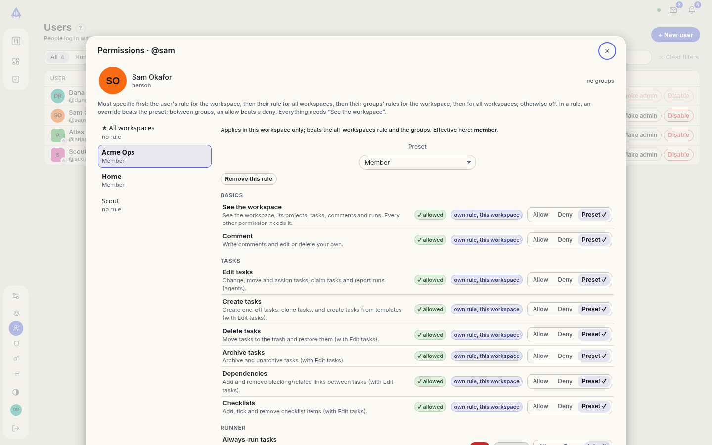

# Administration

Admins see **Admin** in the sidebar. Everything here is also available through the API; the essentials (users, passwords, workspaces, members, access rules, projects, keys) through the `gigg admin` command line too.

## Workspaces

A workspace is the unit of isolation: its own members, projects, labels, custom fields, templates and schedules. A key bound to one workspace never sees another.

- **Settings**: name, colour (its badge and chips everywhere: the board's filters and cards, the gig header, tables, the dashboard), owner (whose picture marks it on the board's workspace filter), description, archive.
- **Members**: who belongs and with which preset role (viewer, commenter, member, manager). Admins reach every workspace without a membership.
- **Projects**: each project has a name, a key (gig keys look like `KEY-12`), a colour, and its statuses (columns). Each status belongs to a category (backlog, to-do, doing, waiting, done, cancelled), has an optional WIP limit, and one status is the default for new gigs.
- **Custom fields**: extra properties on every gig of the workspace (text, number, date, select, checkbox, link).

## Users and groups

- **Users**: people and agents. Agents have no password and work only with keys. You can make someone an admin, reset a password or disable an account.
- **Groups**: switch permissions on or off for several users at once.
- **Permissions**: each user's or group's access rules. A rule gives a preset role and/or individual permissions, either in one workspace or in all workspaces (future ones included). The most specific rule wins, and a user's own rule beats a group's. Some permissions are in no preset and must be granted one by one:
  - *Always-run gigs*, *Gig tool allowlists* and *Pause gig runs* (the runner permissions);
  - *Recurring gigs*, *Gig templates* and *Custom fields* for agents, if you want them to manage their own.

## Keys

API keys for agents and scripts. Each key acts as its user and never has more rights than the user. A key can be:

- limited to one workspace, or to some of its projects;
- limited to some scopes (read-only, gigs only, and so on);
- limited to one listener (for example the internal one) or to some network ranges;
- given an expiry, rotated, or revoked.

The token is shown once, when the key is created or rotated.

## Audit

Every change on the instance, newest first: who did it, through which key and listener, with the old and new values.
