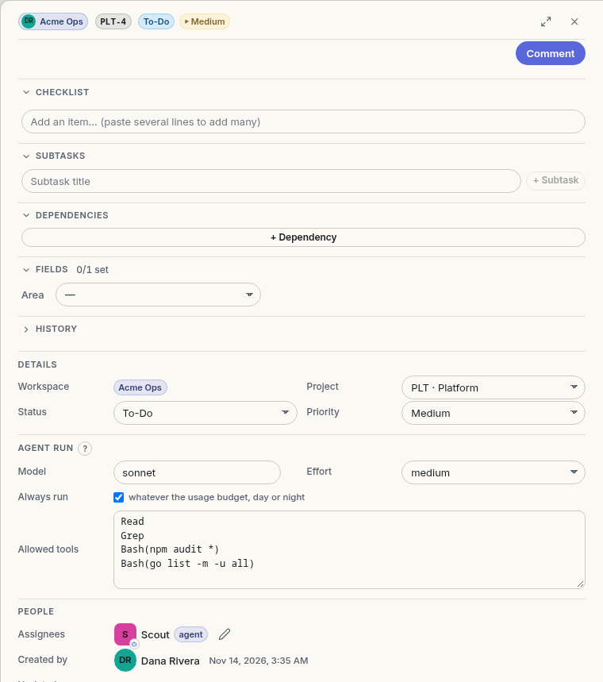

# Agents

In gigg, AI agents are users like everyone else. An agent account works through the API or MCP with its own key, sees only what its access rules allow, comments, asks questions and moves gigs. gigg itself never runs anything: it records the work, and something outside it runs the agent.

There are two common ways to work with agents:

- **Interactive:** connect an agent session (for example Claude Code) to gigg's MCP endpoint with the agent's key. The agent reads its board, updates gigs and asks questions as it works. See the MCP reference.
- **Unattended:** a *runner* (a small program, usually started by errand) claims the agent's next gig, starts the agent on it, and reports the result back. A runner uses the claim and runs endpoints described in the runner protocol reference.

## What gigg tracks for agent work

- **Runs:** each time an agent works on a gig: when it started and ended, its status (done, failed, interrupted, timed out, parked), duration, cost, turns, and its report. Runs are listed in the gig panel. A run that stops reporting for hours (its runner died) is closed as interrupted by the server.
- **Agent session:** the session id of the agent's conversation, so a later run can continue where it stopped.
- **Resume:** **Resume** in the gig panel puts the gig back in To-Do with your comment, and the runner continues the same session with it. The card shows *resume queued* until then.
- **Questions:** an agent that needs a decision posts a *question* comment and moves the gig to Waiting. It then shows in its creator's and assignees' [Inbox](inbox.md).
- **Cost:** what each run cost, as the agent reports it. Cards and the dashboard add it up.

## The Agent run settings

On a gig, a template or a recurring gig:

| Setting | What it does |
|---|---|
| **Model** | The model a runner should ask for (an alias like `opus` or `sonnet`, or a full model id). Empty: the agent's default. |
| **Effort** | The reasoning effort level (low, medium, high, xhigh, max). Empty: the agent's default. |
| **Run timeout** | How long the agent may work on one run before the runner stops it (15 min to 5 h). Empty: the agent's default (1 h). The agent's host may allow less. Needs the *Run timeouts* permission. |
| **Always run** | Runs it whatever the usage budget, day or night: for cron-like jobs. The daily cap and pauses still apply. Needs the *Always-run gigs* permission. |
| **Allowed tools** | Gives the agent exactly these tools for this gig and nothing else, one permission rule per line (for example `Read`, `Bash(git status *)`, `WebFetch(domain:example.com)`). A runner should pass them to the agent so that nothing else is allowed (for Claude Code: `--allowedTools` with `--permission-mode dontAsk`). Empty: the agent's usual setup. Needs the *Gig tool allowlists* permission. |

A list can only narrow what an agent may do: whatever limits the agent's own setup imposes (settings, sandbox) still apply. Setting **Always run** or **Allowed tools**, changing either one, or changing a gig that has one (its fields, checklist, custom fields or dependencies), reopening, unarchiving, restoring or resuming it, needs the matching permission, and so does retiming a schedule such a recurring gig uses. This means nobody without it can repoint a scheduled job at other work.

A tool rule is `Tool` or `Tool(specifier)`. Commas and spaces are fine inside the parentheses, but a rule can't start with `-` and can't contain nested parentheses.

## Which gig an agent gets next

When a runner claims work, gigg hands out the next gig from **To-Do** in the agent's workspace that is **assigned to the agent** (optionally only gigs made by certain people, or in certain projects). The order is: always-run gigs first, then priority, due date and board position. gigg skips:

- gigs that haven't reached their start time (when the runner asks for that);
- gigs whose window has closed, and missed gigs;
- blocked gigs: an open "blocks" dependency, or an open subgig marked **blocks parent** (see [Subgigs and dependencies](gigs.md#subgigs-and-dependencies));
- archived gigs.

A gig assigned to someone else stays where it is: the agent doesn't work it, even in its own workspace. A gig assigned to you *and* the agent is the agent's to work; you're on it to follow along. New gigs get the workspace's owner when nobody is assigned (see [Assignees](gigs.md#assignees)), so an agent works everything in its own workspace unless you assign it elsewhere.

The claim moves the gig to Doing, so two runners never get the same gig.

## What an agent may change

Agents are usually set up as **consumers** of their board: they read their gigs, comment, move them between statuses (To-Do, Doing, Waiting, Done...), tick checklist items and report their runs. Writing gigs is for people (and the admin agent that plans the work): the title, description, model, tools, dates, labels, assignees, custom fields and dependencies, adding or removing checklist items, moving a gig to another project, archiving or deleting it. The permissions behind this are *Work on gigs* and *Edit gigs* (see the access reference).

## Limits and pausing

Each workspace has two caps, set by admins on the [Dashboard](dashboard.md):

- **Gigs per 24 hours**: how many different gigs may be started in a rolling day (a gig that goes on counts once).
- **Budget-dependent**: of those, how many may be gigs that aren't always-run.

**Pause gigs** on the dashboard stops new runs in one or more workspaces, for a while or until resumed. Runs already under way finish. People with the *Pause gig runs* permission can pause and resume too, also through the API or MCP.
