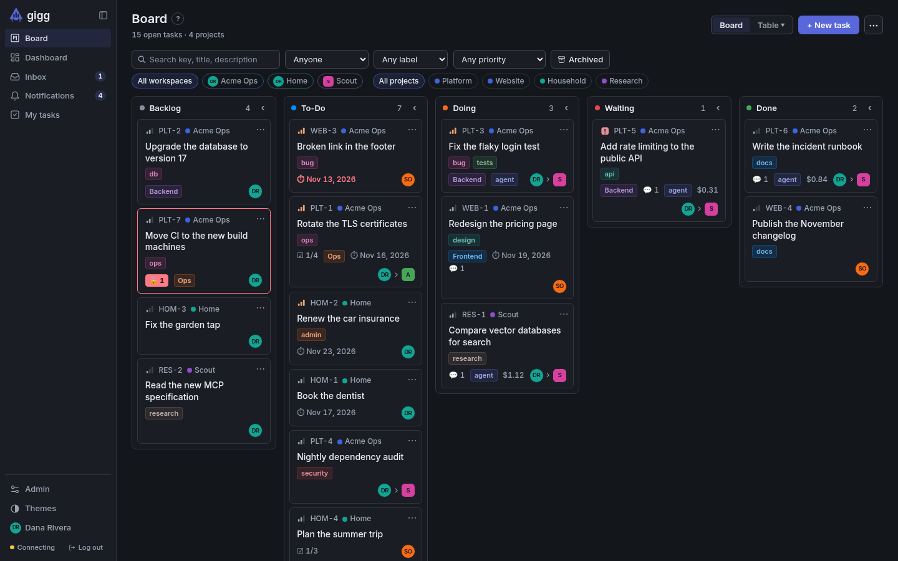
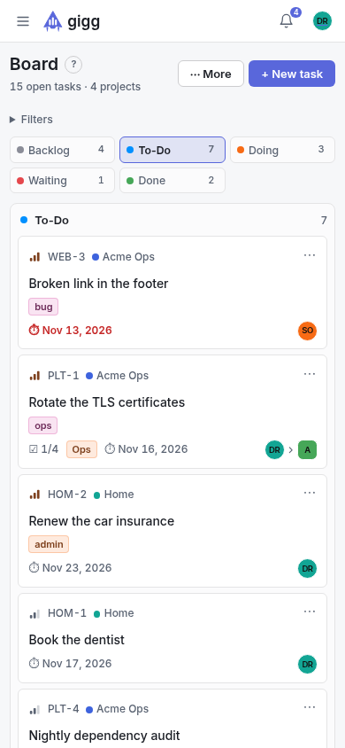
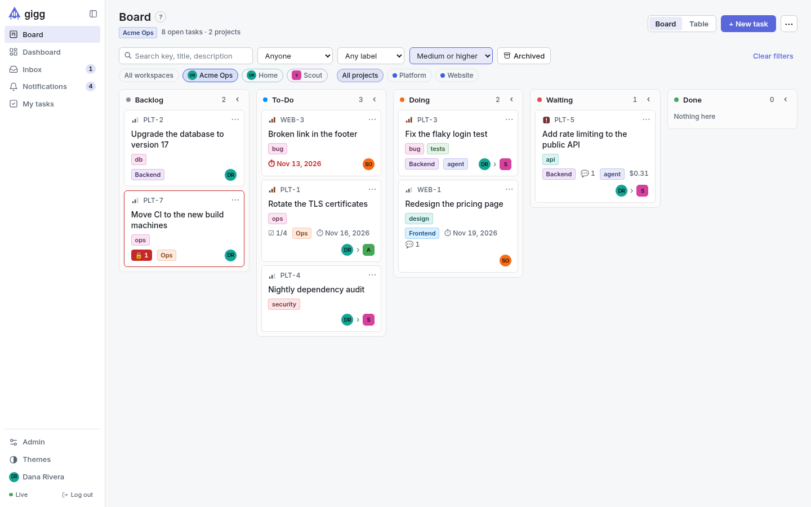
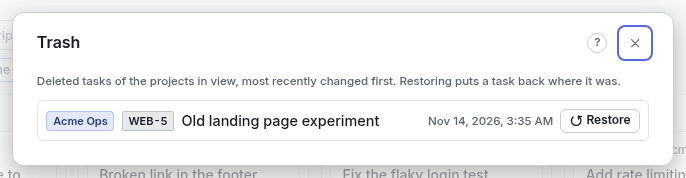

# The board

The board shows the tasks of every workspace and project you can see, in one place. Open it from **Board** in the sidebar.

## Columns

- **Several projects in view:** one column per stage: Backlog, To-Do, Doing, Waiting and Done. A column takes a project's own name for a stage when every project in view uses the same name; otherwise it shows the stage's general name, and each card shows its project's status name (for example "Needs review") when it differs. Cards are ordered by priority, then by the earliest due date.
- **One project in view:** that project's own statuses as columns, in the order you set. Drag cards up and down to reorder them, or use the card's **⋯** menu (To top, Up, Down, To bottom).

Cancelled tasks don't appear on the board. Use the table view to see them.

Each column header shows the column's colour dot, its name and the number of tasks. Click the **‹** that appears when you hover over the header (or tab to it) to collapse the column to a narrow strip (the board remembers this per browser). Click the strip to open it again. On a phone, the columns are tabs above the cards, and the filters fold away under **Filters**.

## Cards

A card is quiet on purpose: a hairline border, the title first, a few facts under it. Hover over (or long-press) any mark to see its tooltip.

- **Top row:** the priority as an icon (three bars for Low, Medium and High, a square with "!" for Urgent; High and Urgent are coloured), the task's key (`KEY-12`: the project's key and the task's number) in grey, and, when several workspaces are in view, the task's workspace (a dot in its colour and its name). When the column is a stage and the task's own status is named differently (for example "Needs review"), that status follows in grey.
- **Title:** up to two lines.
- **Labels:** up to two, as tinted chips; "+3" stands for the rest (hover to list them).
- **Bottom row:** facts as small grey text, then the people.
- **The task's colour:** a coloured stripe on the card's left edge appears only when the task has a colour. A card that is blocked or missed has a red border, and an archived card a dashed one.
- **⋯** (top right, shown when you hover the card or tab to it, and always on a touch screen): move the card (see below).

| Mark | Meaning |
|---|---|
| 🔒 n (red) | Blocked by n open tasks; agents won't pick it up until they're done |
| ☑ 2/5 | Checklist progress |
| ⑂ 1/3 | Subtasks done |
| ⟳ | Made by a recurring task |
| ◷ window / missed (red) | The time window it may be started in; missed if it closed untouched |
| ⏱ date | Due date (red when overdue) |
| 💬 n | Comments |
| agent | An agent has worked on it (it has an agent session) |
| $0.42 | What the agent's runs cost so far |
| resume queued | Someone asked the agent to continue its session |
| a tinted chip | A custom field value (select or checkbox) |

The avatars at the bottom right are the people assigned to the task, overlapping. When there is no assignee, the creator is shown; when a person handed the task to an agent, the creator appears as a smaller picture before the agent. Hover an avatar to see who created the task and who it is assigned to. Agents have square-ish avatars.

## Moving tasks

- Drag a card to another column. With several projects in view, the task goes to its project's first status of that stage (for example, the first "Done" status).
- Or use the card's **⋯** menu: **Move to** lists the task's project statuses, and **Move to project** lists the other projects of its workspace.
- Click a card to open the task panel (see [Tasks](tasks.md)).

## Filters

The toolbar above the columns narrows the board, in one row:

- **Search**: text in the key, title or description.
- **Assignee**: anyone, assigned to you, unassigned, or a person.
- **Label** and **Priority** (a minimum: "High or higher"). A filter that is on is tinted.
- **Archived**: a toggle that shows archived tasks, greyed out, in their columns.
- **Clear filters**: appears only while a filter is on, and resets everything except the archived toggle.

Under the toolbar, small chips scope the board: **Workspaces** and **Projects**. Click a chip to show only that one; click more chips to add them. **All workspaces** / **All projects** clears the selection. The workspace chips show the workspace's owner picture and colour.

The filters live in the page address (for example `/board?ws=acme&pr=3`), so you can bookmark or share a filtered board. The board also remembers the last filter you used.

## The buttons at the top

Next to the title (and its **?** help button) the header has three things:

- **Board | Table**: a switch between this board and the same tasks as a sortable table (per workspace), with bulk actions. See [Views](views.md). With several workspaces in view, **Table** asks which workspace.
- **+ New task**: with one project in view it opens the form right away; otherwise it first asks which project.
- **⋯** (More actions): the less frequent actions.
  - **Recurring**, **Schedules**, **Templates**: see [Recurring tasks](recurring.md).
  - **Archive done**: archives the tasks in Done (all of them, or those done for 7 or 30+ days). Archived tasks leave the board and lists but stay searchable, and you can unarchive them from the task.
  - **Trash**: the deleted tasks of the projects in view, most recently changed first, each with **Restore**, which puts it back in its column. Restoring needs the *Delete tasks* permission.

Actions that act on one project (Recurring, Templates, Archive done, New task) ask which project when several are in view. Schedules asks which workspace. On a phone, **⋯ More** holds the Table links and these actions, and the archived toggle sits in the **Filters** fold.
