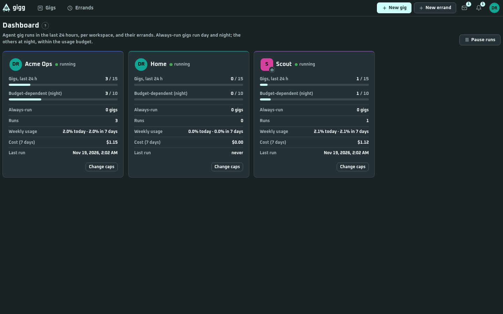

# The dashboard

The dashboard shows each workspace's agent runs over the last 24 hours: how close it is to its caps, what it cost, and whether it's paused.

## A workspace's card

Click a card (or its name) to open the board filtered to that workspace. The card's own buttons, such as **Resume** and **Change caps**, don't open the board.

- **running / paused** (a green or red dot beside the name): whether the workspace's runner may start gigs.
- **Gigs, last 24 h**: different gigs started in a rolling day, against the daily cap.
- **Budget-dependent (night)**: of those, the gigs that aren't always-run, against their own cap. A runner usually runs them only when the usage budget allows, for example at night.
- **Always-run**: always-run gigs in the last 24 hours.
- **Runs**: agent sessions started or resumed (a gig can have several).
- **Weekly usage**: how much of the agent subscription's weekly meter the runs used, if the runner reports it. The meter is shared, so this is an estimate.
- **Cost (7 days)**: what the runs cost, as the agents report it.
- **Last run**: when the latest run started.

Admins can set the caps on each card with **Change caps**.

## Pausing

**Pause runs** (top right) stops new gig runs and errand runs in the workspaces you pick. Untick **Gig runs** or **Errand runs** to pause only one of them. Gig runs pause for a set time or until resumed; errand runs pause until resumed, and the slots they miss meanwhile are never run late. Runs that already started finish. A banner shows what's paused, and **Resume** lifts it.

**Errands** on a card counts the workspace's [errands](errands.md) and how many are failing; it opens the Errands page.

Admins can pause any workspace. Other people can pause the workspaces where they hold the *Pause gig runs* permission (it covers errand runs too) (for a whole team, give it on all workspaces).
