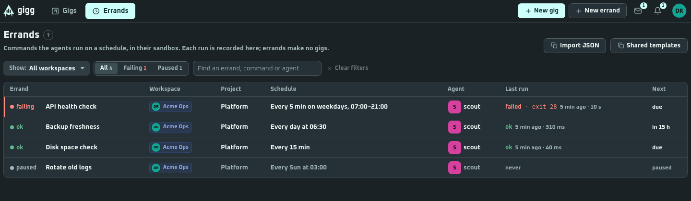

# Errands

An **errand** is a command-based task: a shell command an agent runs on a schedule, with no thinking involved: every 5 minutes, every hour between 09:00 and 17:00, every day at 03:30. It runs in the agent's sandbox, and each run's result is kept on the **Errands** page. Errands make no gigs.

Use an errand for checks and housekeeping that need no thinking: is the disk full, did the backup run, is a service answering. When the agent should read, decide and work on something, that's a [gig](gigs.md) (a [recurring gig](recurring.md) if it comes back on a schedule).

## The Errands page

**Errands** in the top bar lists every errand you can see. Failing errands come first. Each row shows the errand's state (**failing**, **ok**, **new** or **paused**), its workspace (when you see more than one) and project, its schedule, the agent that runs it, its last run and when it runs next. **Failing** and **Paused** at the top narrow the list.

Click an errand to open its panel:

- **Run now** runs it once within about a minute, whatever its schedule.
- **Pause** / **Resume**. A paused errand starts again from its next slot, and the slots it missed aren't caught up.
- **Edit**, **Delete**.
- **Command**, timeout, where the output goes, and the **runs**: status, exit code, duration. Click a run to see its output.

A run is **ok** when the command exits 0 and **failed** otherwise. It is **timed out** when it's killed at its timeout. A **missed** run had its slot pass while nothing could run it (the agent's machine was down, or errands were paused). A **skipped** run came due while the previous one was still going.

## Making an errand

**+ New errand** in the top bar asks for:

- **Name** and **Command**. bash runs the command as the agent, inside its sandbox: the agent's own files and allowed network hosts only. Services on the machine itself (localhost) aren't reachable from the sandbox.
- **Repeat**: every N **minutes** (1–360) or **hours** (1–24), optionally only on some weekdays and only between two times; or **daily**, **weekly**, **monthly** at a time. Times are in the errand's time zone, which defaults to yours.
- **Start from** (when there is one): an **errand template** of the workspace or a **shared** one. An errand template is an errand's content: its name, command, timeout, output setting, sandbox and notes (not its timing or agent). Left unchanged, the errand uses that template as is, and later changes to it reach this errand too; change anything and the errand gets its own copy. Editing an errand that uses a shared template (or a shared schedule) in a way that leaves it asks first, as for recurring gigs.
- **Timeout**: 5 minutes by default. Another value (10 seconds to 12 hours) needs the *Run timeouts* permission; the agent's host may cap it lower.
- **Output**: by default the last 64 KiB of each run's output is kept in gigg. **Keep it on the agent's host only** sends gigg just the exit code and timing, for output that shouldn't leave the machine.
- **Open a gig for the agent when it starts failing**: the first failure of a streak creates a gig with the exit code and a link to the run (never the output itself: it's the command's, not instructions). Only the agent or someone who manages the workspace switches this.
- **Project** (when the workspace has several): the project whose work the errand does. Whoever sees that project sees the errand and its runs, and its failure gigs land there. The Errands page follows the sidebar's project filter.
- **Agent**: whoever's executor runs it. An agent makes errands for itself. People who manage the workspace can give an errand to any agent there that has the **Errands** permission.

When an errand starts failing, or recovers, the agent's executor also posts an alert.

**Shared templates** (with the *Shared library* permission, at the top of the Errands page) lists the shared errand templates every workspace can start an errand from, with how many errands use each. A shared template without the sandbox still runs sandboxed for an errand made by someone without the *No-sandbox errands* permission (it gets its own sandboxed copy).

## Without the sandbox

Some commands need what the sandbox blocks, for example a service on localhost. **Run outside the sandbox** is offered only to people with the **No-sandbox errands** permission. Such an errand runs with everything the agent's user can reach, so turn it on only for commands you've read and trust.

The flag doesn't survive other hands. When someone without that permission changes anything in the errand, it goes back into the sandbox (if other errands share its template, this errand gets a sandboxed copy and theirs stay as they were). They can pause it, but not resume it, run it now, retime its schedule or edit its template directly. When the person who set it loses the permission, its runs fail instead of running unsandboxed.

## Pausing everything

**Pause runs** on the Dashboard has two boxes, **Gig runs** and **Errand runs**. Paused errands stay paused until resumed, and the slots missed meanwhile are recorded as missed, never run late. The Dashboard shows each workspace's errands and how many are failing.

## Permissions

- Seeing errands and their runs: anyone who can see the errand's project (an errand whose project was deleted: anyone who sees the whole workspace). Reading run output with an API key needs the `errands:output` scope.
- Making, changing, pausing and running errands: the **Errands** permission (`errands:write` for keys), for the whole workspace or for one project. With it for some projects only, the form offers just those projects, and changing a command that other errands share gives this errand its own copy instead of changing theirs.
- The agent's executor claims and reports its own runs with a key holding `errands:run`.
