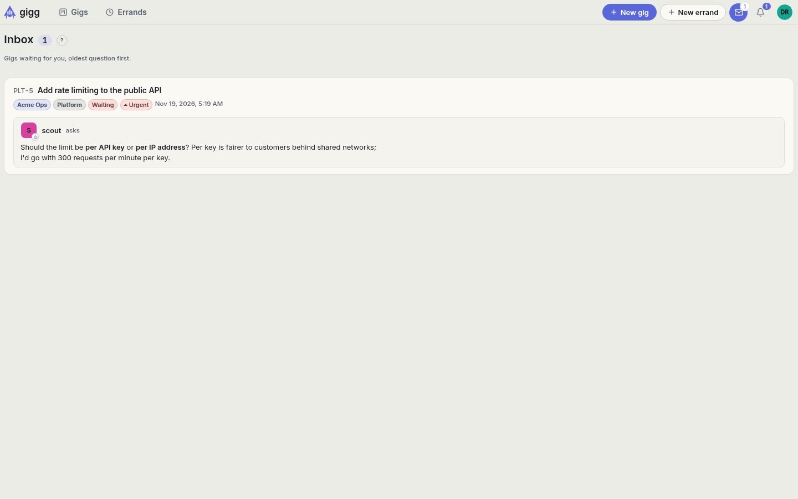

# Inbox and notifications

## Inbox

The **Inbox** lists every gig in a Waiting status across the workspaces you can see, oldest question first: usually an agent asked a question and needs a person. Each row shows the latest question and who asked it. Open the gig, answer in a comment, then move it back to To-Do, or use **Resume** so the agent continues where it stopped.

The envelope in the top-right corner of every page opens the inbox. Its badge shows how many gigs are waiting.

## Notifications

The bell in the top-right corner collects what happened to you. Click it to open the list under it (on a phone it opens the notifications page):

| Kind | When | Setting (Profile → Bell) |
|---|---|---|
| mention | Someone wrote `@you` in a gig description or a comment | Mentioned (on) |
| assigned | You were assigned a gig | Assigned to you (on) |
| question | Someone asked a question on a gig you follow or are assigned to | Needs a person (on) |
| failed | An agent's run on such a gig ended in an error or timed out | Needs a person (on) |
| report | Someone posted a report (a run finished cleanly) on such a gig | Finished (off) |
| missed | Such a gig wasn't started before its window closed | Missed window (on) |

**Following.** Anyone who can see a gig can follow it with **Follow** at the top of its panel, or be named in its **Followers** (in the gig form, on create or later). Followers hear about a gig as its assignees do. You follow the gigs you create, unless you turn off **Follow the gigs I create** in your profile, for example when you file gigs for others and name who should follow them. A template's followers follow every gig made from it, recurring ones included. Someone who can no longer see a gig hears nothing about it.

Click one to open the gig. **Mark all read** clears the badge. The command palette (**Ctrl+K**) also has a **Notifications** page with the full list.

## Live updates

Changes by others, people or agents, appear within a second or two over a live connection to the server. A short drop (a restart, a network blip) passes unnoticed: the page reconnects and catches up on what it missed. When the connection has been gone for 30 seconds, a bar under the top bar says so (the page may be out of date), with **Retry now**; when the connection is back, the bar goes, "Reconnected" shows, and the page refreshes.

A request that fails on a network blip or a busy server is tried again a few times on its own (0.5 s, 1 s, 2 s) before an error shows. Creating something is safe to repeat: the server recognises the repeat and answers it once, and when the first try is merely slow, the page waits for it (up to about 30 s) instead of showing an error.
