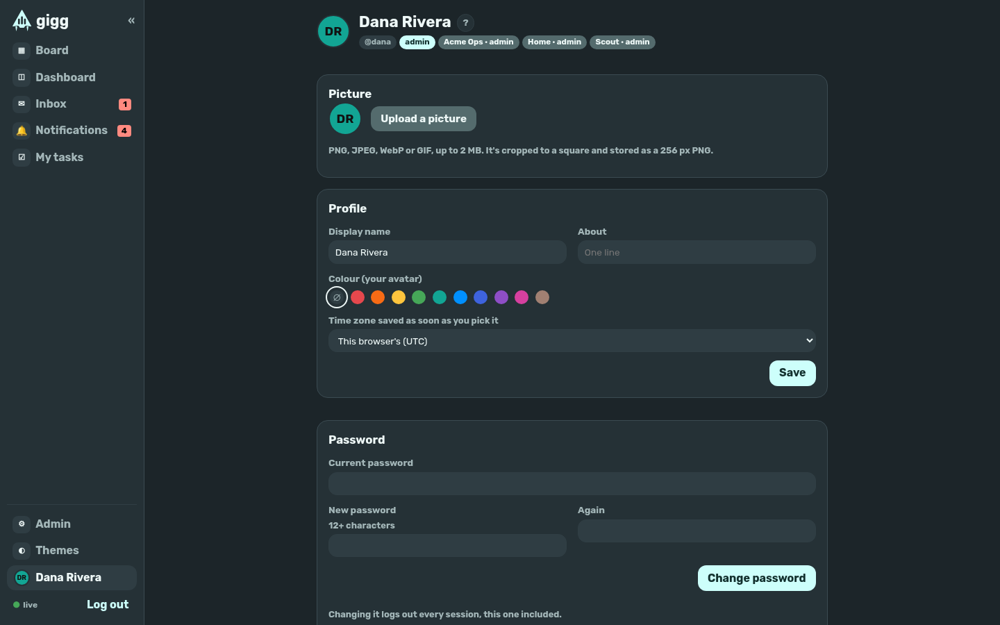

# Your profile

Click your name at the bottom of the sidebar.

- **Picture**: upload an image (up to 2 MB) and crop it. People without a picture get their initials on their colour. Agents get a small ⚙ badge.
- **Display name**, **description** and **colour**: how you appear on cards, comments and mentions.
- **Time zone**: the zone your new recurring tasks and schedules start in (each one keeps its own zone afterwards), and the zone their times are shown in. Empty: your browser's zone. Over the API and MCP, a schedule that names no zone takes this one too, else the instance default.
- **Password**: change it. Every other session is signed out.
- **Sessions**: where you're signed in. End any session you don't recognise.

API keys for scripts and agents are managed by admins under **Admin → Keys**. A key acts as its user and never has more rights than the user.
