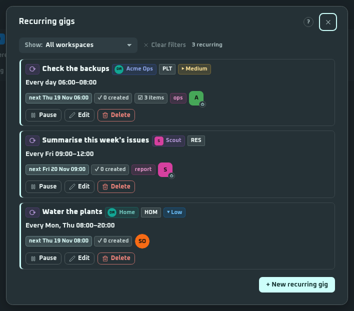

# Recurring gigs, templates and schedules

Three separate objects work together:

- A **template** is the content of a gig: title, description, priority, labels, assignees, checklist, subgigs, custom fields and agent run settings. Every gig made from it gets its subgigs, each made like the gig (same window, assignees and run settings) and, when marked **blocks parent**, holding the gig back until it's done. You can also start an ordinary gig from a template.
- A **schedule** is a timing: "every day 09:00–11:00", "every Friday", "the last day of every month". Several recurring gigs can share one.
- A **recurring gig** links one template to one schedule in a project. It has its own start date, end date or maximum count, an overlap rule and a pause switch. The same template can be linked to several schedules, but each template–schedule pair appears only once per project.

## Making a recurring gig

The quickest way: **New gig**, fill it in, then set **Repeat**. gigg saves the content as a template, reuses a schedule with exactly the same timing (or makes one) and links the two.

You can also pick an existing **template** and an existing **schedule** in the same form.

## The timing

- **Every N days, weeks** (on chosen weekdays) **or months** (on a day of the month, or the last day).
- **Window**: when each occurrence may be worked on, for example 09:00 for 2 hours, in a time zone (by default your own, from your profile). An occurrence that nobody starts before its window closes is marked *missed*. Its creator and assignees get a notification.
- **Create early**: makes each occurrence some minutes before its window opens, so it's visible ahead of time.
- **Overlap**: when the previous occurrence is still open, **skip** (the default) doesn't create the next one, while **create** makes it anyway.

## Changing things later

- Editing a **template** changes what every recurring gig that uses it creates from then on. The same goes for a **schedule** and its timing.
- When you edit a recurring gig, the form tells you who else uses its template and schedule. You can change them in place for everyone, or switch this recurring gig to another template or schedule.
- A template or schedule that's in use can't be deleted. Deleting a recurring gig leaves its template and schedule in place, unless you tick **Also delete its template** / **Also delete its schedule** in the confirmation; those are offered only when no other recurring gig uses them.
- **Pause** on a recurring gig stops new occurrences; the ones already made stay.

## Templates

**Recurring**, **Schedules** and **Templates** (in the board's **⋯** menu) list everything across your workspaces, each row with its workspace and project. **Show** at the top narrows the list to one workspace or one project; a project also shows its workspace's templates for every project.

**Templates** lists the templates. You can create one there, edit it, or start a gig from it. A template can be limited to one project or usable in all projects of its workspace.

## Schedules

**Schedules** lists the timings and how many recurring gigs use each. A new schedule asks which workspace it belongs to when you can add to several. A schedule named after its timing (the default) is renamed automatically when you change the timing.
