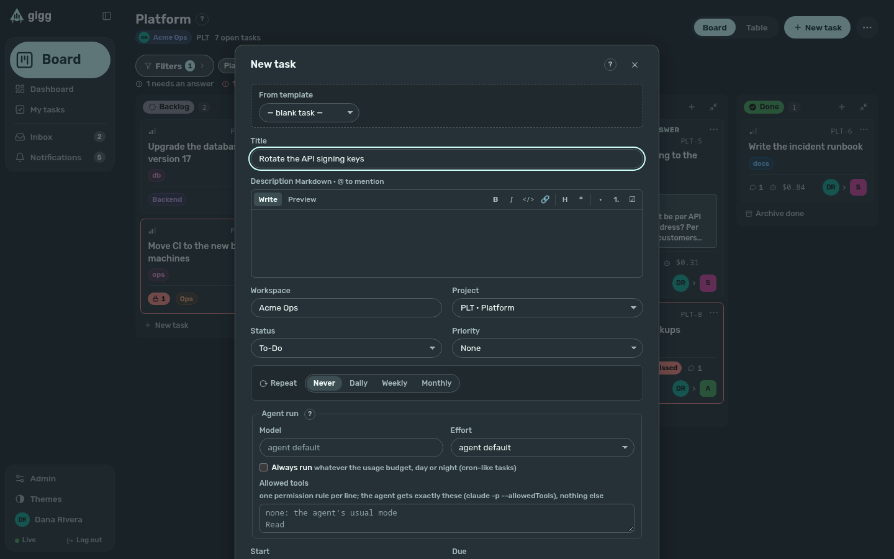

# Tasks

A task belongs to one project of one workspace. Its key (for example `GIG-12`) is the project's key plus a number. When a task moves to another project it gets a new key, and the old key keeps working as an alias.

## Creating a task

Click **New task** on the board. You can also press **Ctrl+K** (⌘K on a Mac) and choose "New task".

- **Title** and **Description**: the description is Markdown. Type `@` to mention someone; they get a notification.
- **Status**, **Priority**, **Labels** (new labels are created as you type), **Assignees**, **Colour** (the card's left edge).
- **Start** and **Due**: dates with an optional time. A task with a start date in the future isn't picked up by agents before then.
- **Checklist**: one item per line.
- **Template**: start from a saved template, or save this form as one (**Save as template**).
- **Repeat**: turns the task into a recurring task. See [Recurring tasks](recurring.md).
- **Agent run**: model, effort, always run, allowed tools. See [Agents](agents.md).
- Custom fields, if your workspace has any, are under **More**.

## The task panel

Click a card to open its panel. Its top line shows the workspace (its owner's picture and name, in its colour), the task's key, its status and its badges. The expand button (two diagonal arrows, top right) widens it, and the close button (×) or Esc closes it. Every field saves when you change it.

- **Properties**: workspace, project (move it to another project), status, priority, agent run settings, assignees, dates and the time window, labels, colour.
- **Description**: click to edit. Markdown, with checkboxes you can tick in place.
- **Checklist**, **Subtasks**, **Dependencies** and **Fields** are folding sections (click a section's title to fold it):
- **Checklist**: add, tick, reorder and remove items.
- **Subtasks**: tasks whose parent is this one. Their progress shows on the parent's card.
- **Dependencies**: "blocks", "blocked by" and "relates to" links between tasks. A blocked task shows 🔒, and agents leave it alone until its blockers are done.
- **Custom fields**: the workspace's extra fields (text, number, date, select, checkbox, link).
- **Comments**: Markdown, with @mentions. Agents' comments are marked by kind:
  - *question*: they need an answer; the task goes to the [Inbox](inbox.md).
  - *report*: what they did.
  - *system*: the runner's own notes.
- **Runs** and **Agent session**: each time an agent worked on the task, with status, duration, cost and its report. **Resume** asks the agent to continue its previous session, with your comment as the next instruction.
- **Clone**, **Archive** / **Unarchive** and **Delete** are at the bottom of the panel.

## Time windows and missed tasks

A task can have a window: it may only be started between its start time and **Window closes**. If nobody starts it before the window closes, it's marked **missed** and its creator and assignees get a notification. Recurring tasks use windows to make sure a daily task doesn't run late.

## Archiving and deleting

- **Archive** (at the bottom of the panel, or **Archive done** on the board): the task leaves the board and lists, stays searchable, and can be unarchived.
- **Delete** moves the task to the trash. **Trash** on the board lists the deleted tasks of the projects in view, with **Restore**. A deleted task opened from a link shows **Restore** too.
- Every change is recorded with its old and new values: the API's task activity (`GET /tasks/{id}/activity`) and, for admins, **Admin → Audit**.
