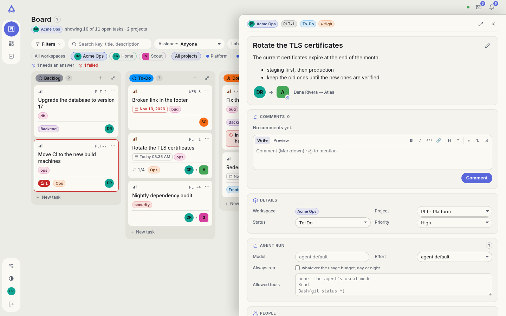

# Tasks

A task belongs to one project of one workspace. Its key (for example `GIG-12`) is the project's key plus a number. When a task moves to another project it gets a new key, and the old key keeps working as an alias.

## Creating a task

Click **New task** on the board. You can also press **Ctrl+K** (⌘K on a Mac) and choose "New task".

The form is an open task's [panel](#the-task-panel): the same editor, with the same boxes in the same order and the same rows and controls. The **New/Edit template** and **New/Edit recurring task** dialogs are the same editor too; each shows only the boxes that apply (a template has no **When**, only a single new task has **Dependencies**). The title and description show as the task will read, the description folded when long (**show more** opens it), with the pencil to edit them; a new task starts in the editor, and **Done** folds it back.

- **The task**: **From template** (when there are templates: fill the form from one, or create the task from it as is), the **Title** and the **Description** (Markdown; type `@` to mention someone, and they get a notification). A template also has its **Template name** here.
- **Checklist**: add items one by one, or paste several lines at once; reorder and remove them.
- **Subtasks**: tasks created together with this one. See [Subtasks and dependencies](#subtasks-and-dependencies).
- **Where**: **Workspace**, **Project** and **Status**. The form starts in the project in view (else the one you used last); pick any workspace and project you can add to. Moving the task to another project keeps its stage (To-Do, Doing…) in that project's statuses; moving it to another workspace clears the custom fields, the dependencies, the picked template and the assignees who aren't members there.
- **When**: **Start**, **Due** and **Window closes**, dates with an optional time (a task with a start date in the future isn't picked up by agents before then; see [time windows](#time-windows-and-missed-tasks)), and **Repeat**, which turns the task into a recurring task (shown when you have the Schedules permission in that workspace). See [Recurring tasks](recurring.md).
- **Details**: **Priority**, **Labels** (new labels are created as you type), **Assignees** and **Colour** (the card's left edge).
- **Agent run**: model, effort, always run, allowed tools. See [Agents](agents.md).
- **Dependencies**: tasks this one blocks, is blocked by, or relates to, linked when it's created.
- **Fields** (when the workspace has custom fields): their values, with a count of how many are set.

**Repeat** adds its settings to the **When** rows, each label on the left and its controls on the right: how often (**Daily**, **Weekly**, **Monthly**), the **Schedule** to run on (or custom timing), **Every**, the days (**On**), **Time** (all day or a window **From** a time **for** a length), how many minutes early to **Create** each task, when it **Ends**, the **Options**, and the **Next** three occurrences. The **Edit schedule** dialog uses the same rows.

Everything you add is saved when you click **Create task** (or **Save**): the subtasks, checklist and dependencies are made together with the task, so a mistake in one of them creates nothing. **Save as template** at the bottom keeps the form as a template. The expand button (two diagonal arrows, top right) grows the form to the whole page, with the task, checklist and subtasks on the left and the rest on the right, like an expanded panel; your browser remembers the choice for the next time.

## The task panel

Click a card to open its panel. Its top line shows the workspace (its owner's picture and name, in its colour), the task's key, its status and its badges. The expand button (two diagonal arrows, top right) widens it, and the close button (×) or Esc closes it. Every field saves when you change it.

The panel has the same layout as the **New task** form, each part in its own box, with the same controls; the panel saves each change as you make it. The task's content comes first: title and description, **Checklist**, **Subtasks** and **Comments**. Then the properties, in the form's order (**Where**, **When**, **Details**, **Agent run**), the agent session, and **Dependencies**, **Fields** and **History**. When the panel is expanded and wide enough, the content takes the left column and the rest the right.

- **Description**: click to edit. Markdown, with checkboxes you can tick in place.
- **Comments**: Markdown, with @mentions. Agents' comments are marked by kind:
  - *question*: they need an answer; the task goes to the [Inbox](inbox.md).
  - *report*: what they did.
  - *system*: the runner's own notes.
- A long description or comment shows its first part, fading out, with a **Show more** bar under it. **Show less** folds it again, and every task opens with long text folded.
- **Where**: workspace, project (move it to another project) and status. **When**: start, due, the time window and, for a recurring task's tasks, the schedule it came from. **Details**: priority, labels (type to add, × to remove), assignees (click a person to assign or unassign them), colour (the card's left edge), who created it and when it last changed. **Agent run**: the agent's run settings. Fields you can't change (a viewer's) show with a dashed outline.
- **Checklist**, **Subtasks**, **Dependencies**, **Fields** and **History** are folding sections, folded when a task opens. A folded section is just its title row: click it (the arrow on the right shows which way it goes) to open it. Its badge (progress, count) shows while it's folded.
  - **Checklist**: add, tick, reorder and remove items.
  - **Subtasks**: tasks whose parent is this one, each with its **blocks parent** switch. Their progress shows on the parent's card. A subtask's own panel names its parent here, with its switch.
  - **Dependencies**: "blocks", "blocked by" and "relates to" links between tasks. A blocked task shows 🔒, and agents leave it alone until its blockers are done. Subtasks that block the task are listed under "Blocked by" too, tagged *subtask* (switch them off in **Subtasks**).
  - **Fields**: the workspace's custom fields (text, number, date, select, checkbox, link).
  - **History**: who changed what and when, newest first: edits, moves, links, checklist changes, comments and agent runs. It updates live. The admin audit log keeps the rest (which key, from where).
- **Agent session** (folding): the resume command, each run with status, duration and cost, and the transcript path. **Resume** asks the agent to continue its previous session, with your text as the next instruction. It's folded unless the agent is waiting for your answer.
- **Clone**, **Archive** / **Unarchive** and **Delete** are at the bottom of the panel. **Clone** copies the task's content, labels, assignees, dates, custom fields and checklist (every item unticked), but not its subtasks, dependencies, comments or runs.

## Subtasks and dependencies

Both link tasks, for different reasons:

- A **subtask** is *part of* its parent: a full task of its own (status, assignees, comments, agent runs) that belongs under one parent. The parent's card shows how many are done. A subtask added in the panel or the form is made like its parent: same project, priority, assignees, dates and agent run settings.
- A **dependency** is about *order*: "A blocks B" means B can't be started until A is done or cancelled. It links any two tasks of a workspace, whatever their parents.

By default a subtask doesn't hold anything back: agents may pick up the parent and its subtasks in any order. Tick **blocks parent** on a subtask to make its parent wait for it, like a dependency: while that subtask is open, the parent shows 🔒 and agents don't pick it up. This suits a parent that is the wrap-up of its parts ("tests pass" before "ship the release"), while a side job ("update the wiki") can stay unticked.

Neither is a queue: agents never run a chain back to back. Among the tasks that aren't held back, they take the next one by the usual order (see [Agents](agents.md#which-task-an-agent-gets-next)). gigg refuses a link that would make a cycle, where two tasks would each wait for the other.

## Time windows and missed tasks

A task can have a window: it may only be started between its start time and **Window closes**. If nobody starts it before the window closes, it's marked **missed** and its creator and assignees get a notification. Recurring tasks use windows to make sure a daily task doesn't run late.

## Archiving and deleting

- **Archive** (at the bottom of the panel, or **Archive done** on the board): the task leaves the board and lists, stays searchable, and can be unarchived. An archived task no longer blocks anything (as a dependency or a **blocks parent** subtask).
- **Delete** moves the task to the trash. **Trash** on the board lists the deleted tasks of the projects in view, with **Restore**. A deleted task opened from a link shows **Restore** too.
- Every change is recorded with its old and new values: the API's task activity (`GET /tasks/{id}/activity`) and, for admins, **Admin → Audit**.
