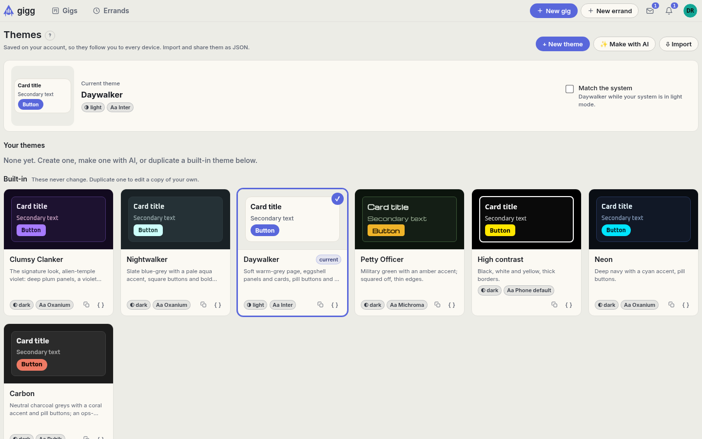

# Themes

**Themes** in the account menu (your picture, top right) changes how gigg looks for you. The choice is saved on the server, so it follows you to other browsers.

- **Built-in** themes: Nightwalker (dark), Daywalker (light), Clumsy Clanker (violet and fuchsia, square buttons), Petty Officer, Neon, Carbon (neutral charcoal with a coral accent) and High contrast. Daywalker, Neon and Carbon use pill-shaped buttons; the others, Nightwalker included, follow their corners.
- **Match the system** switches between a light and a dark theme when your device does.
- **Your themes**: **New theme** starts from colours you pick; **Duplicate** copies any theme to edit. Each colour field shows its contrast against the text, so a theme stays readable.
- **Import**: paste a theme's JSON. gigg also finds the JSON inside surrounding text. **Copy JSON** shares one.

Data colours (labels, statuses, priorities, workspaces, people) keep their hues in every theme. Their text colour is picked for contrast.

## Fonts

The 20 fonts in the editor come with gigg, so a page never contacts Google on its own. **More Google fonts…** takes any other Google Fonts family by its exact name, but only after you press **Load from Google Fonts**: from then on this browser loads such fonts from Google, which sees your IP address. Until then, a theme with such a font shows your system font, and the Themes page offers the same button. An admin can turn Google Fonts off for the whole server (`GIGG_REMOTE_FONTS=off`).

Each contrast warning has a **Fix** that nudges one colour until it passes. It checks every pair that colour is part of, so fixing one warning doesn't make another one worse.

## Theme options beyond colours

Besides the colours, font, text size, corners and border width, the editor has four options that only gigg uses. Other apps that read the same theme JSON ignore them: a theme from such an app imports as before, and a gigg theme copied into one keeps its colours and font but not these four:

- **Buttons and badges**: *Follow the corners* (the theme's corner size) or *Pill* (fully round buttons, fields, chips and badges).
- **Board columns**: the colour of the board's columns. *Auto* (**A**) takes a step between the background and the cards.
- **Column borders**: an outline around each column (at least 1 px, even with a border width of 0), or none (**∅**). When **Board columns** has a colour of its own, the contrast check also covers the secondary text on it and whether each status chip still stands out from it, and its **Fix** adjusts the column colour. The preview shows a column with two status chips and a card.
- **Logo**: the colour of the gigg ship at the top left. *Auto* (**A**) uses the accent. The preview at the top of the editor shows it.

Cards use the theme's **Borders** colour and **Border width**, so changing those shows on the board.

