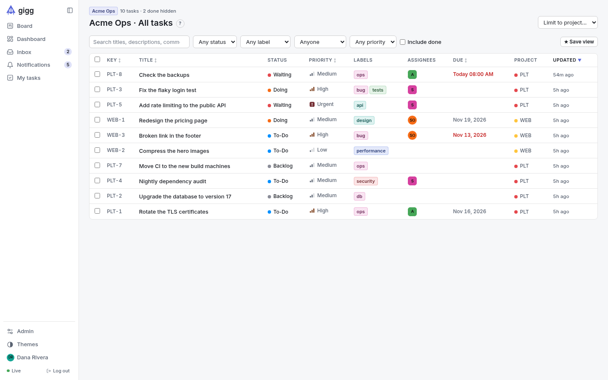
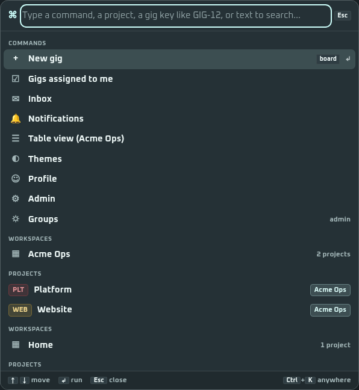

# Tables, saved views and the command palette

Your own gigs: the board's **More filters** › **Assignee** › **Assigned to me** (or *Gigs assigned to me* in the command palette).

## The table

**Table** on the board opens the gigs in view as a table (the Title cell shows the marks a card has: 🔒 with the number of open blockers, and "↳ KEY-8" on a subgig; click a row to open the gig's panel over the table; closing it leaves the table as it was): one project's, one workspace's, or every workspace's. The workspace filter (first after the search) moves between them and keeps your other filters; **Clear filters** goes back to every workspace. Across workspaces, each workspace's gigs are fetched and merged (up to 1,000 per workspace, in the order you sort by; the count shows a **+** and a note at the bottom when there are more: narrow the filters, or open that workspace's table to page through all of it). A view saved there covers every workspace.

- Sort by any column header.
- Filter by status category, label, assignee, minimum priority, recurring (hide the gigs a recurring gig made, or show only those), always run (hide the always-run gigs, or show only those), custom fields, or text (titles, descriptions and comments).
- **Custom fields** in **More filters**: a choice field by one of its options, a checkbox by ticked or not, a number by a comparison (=, ≥, ≤, >, <) and a value, a text or URL field by the words it contains; **No value** finds the gigs where the field is empty. Date fields can't be filtered yet. Across workspaces, a filter on one workspace's field leaves out the gigs of the others.
- **Columns** (in **More filters**) adds a custom field's values as a column (on a phone, a line on each card). **Clear filters** keeps the columns.
- By default the table hides done and cancelled gigs; the count says how many (*N done or cancelled hidden*). **Include done** shows them.
- Select rows to act on several gigs at once: move to a status, set the priority, add a label, assign or unassign someone, or delete.
- **Save view** keeps the current filters (and the field columns) under a name. Saved views appear in the account menu (your picture, top right).

## The command palette

Press **Ctrl+K** (⌘K on a Mac) anywhere. Type to find a gig by key or title, jump to a workspace or project, or run a command such as *New gig*, *Recurring*, *Templates*, *Schedules*, *Errands* or *New errand* (the board's tools open as from the account menu). Use the arrow keys and Enter to choose, and Esc to close.

## Keyboard

Press **?** anywhere for the list of keyboard shortcuts (it's also the palette's *Keyboard shortcuts* command). Besides Ctrl+K:

- **/** puts the cursor in the page's search field (the board's, the table's, the errands'); when the page has none in view, for example with the board's filters folded, it opens the command palette.
- **N** starts a new gig, like **+ New gig**.
- **Esc** closes a dialog, the gig panel or a menu; closing a dialog puts the focus back on the button that opened it (or on the menu button, when it came from a menu).

Single keys don't fire while you type in a field or the editor, or while a dialog is open.

The first Tab on any page reaches a **Skip to board** link (**Skip to content** on other pages), which jumps past the top bar and the filters to the first card. Rows of colour swatches (gig and template colours, the theme editor) are one Tab stop each: the arrow keys pick the previous or next colour, Home and End the first and last. In the theme editor, Esc leaves like Cancel; with unsaved changes it asks once first.
