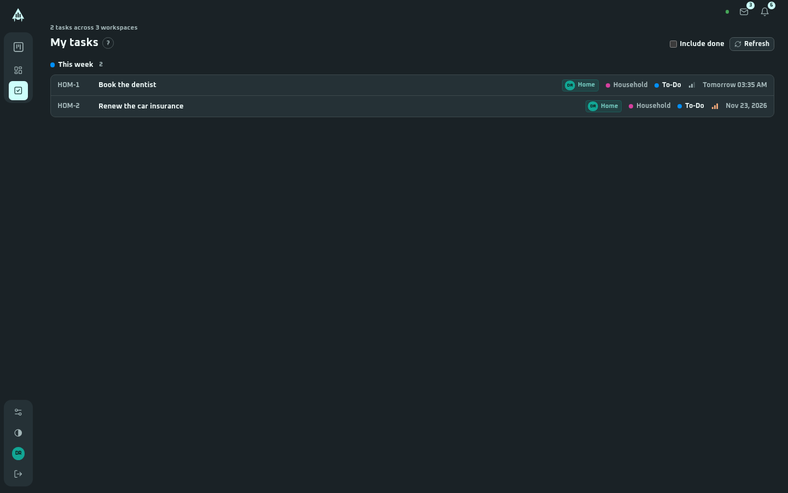

# My tasks, tables, saved views and the command palette

## My tasks

**My tasks** lists the open tasks assigned to you across every workspace, grouped by when they're due: overdue, today, this week, later, no date.

## The table

**Table** on the board opens the tasks in view as a table (click a row to open the task's panel over the table; closing it leaves the table as it was): one project's, one workspace's, or every workspace's. The **Show** filter at the top moves between them and keeps your other filters. Across workspaces, each workspace's tasks are fetched and merged (up to 1,000 per workspace, in the order you sort by; the count shows a **+** and a note at the bottom when there are more: narrow the filters, or open that workspace's table to page through all of it). A view saved there covers every workspace.

- Sort by any column header.
- Filter by status category, label, assignee, minimum priority, custom fields, or text (titles, descriptions and comments).
- Select rows to act on several tasks at once: move to a status, set the priority, add a label, assign or unassign someone, or delete.
- **Save view** keeps the current filters under a name. Saved views appear in the sidebar under **My tasks**.

## The command palette

Press **Ctrl+K** (⌘K on a Mac) anywhere. Type to find a task by key or title, jump to a workspace or project, or run a command such as *New task*. Use the arrow keys and Enter to choose, and Esc to close.

